Hi, I'm Ken. I'm a full stack developer and freelancer. I build **.NET Core** APIs and **Angular** front ends, and I take an app from the database all the way to the screen.

## Now

## Client work

Private repos I'm building for clients right now. The code isn't public, so there are no links.

- **Link Solutions · LinkHQ** - the main LinkHQ app
- **Link Solutions · LinkHQ Website** - the LinkHQ marketing site
- **Finance System** - a finance management system
- **Generator Landing AI** - an AI generator landing page

## Projects

- [Authentication.API](https://github.com/kdsabella/Authentication.API) - auth backend in .NET Core (C#)
- [Authentication.UI](https://github.com/kdsabella/Authentication.UI) - Angular front end for the auth API
- [TodoApp.API](https://github.com/kdsabella/TodoApp.API) - .NET Core REST API for a todo app
- [TodoApp.UI](https://github.com/kdsabella/TodoApp.UI) - Angular + TypeScript client for TodoApp.API

## Stack

